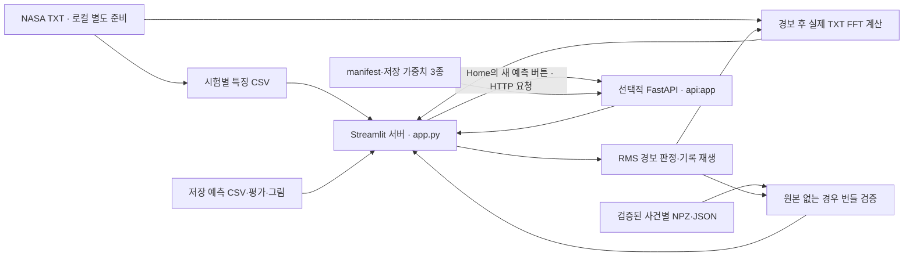

# Streamlit·FastAPI 배포 및 장애 대응 가이드

이 문서는 현재 작업 트리의 [app.py](app.py), [api.py](api.py), 배포 설정과 저장 검증 보고서를 기준으로 작성했습니다. 프로젝트 목적·모델 평가·대리 RUL의 한계는 [README.md](README.md)를 참고하세요. 교육·포트폴리오용 과거 측정 기록 재생이며, 실제 설비 제어·실시간 센서 수집 시스템이 아닙니다.

## 1. 배포 구조와 확인 범위

Streamlit 시연 주소: **https://bearing-pdm.streamlit.app/**

| 구성요소 | 코드에서 확인한 역할 | 실제 서비스 검증 상태 |
|---|---|---|
| Streamlit Community Cloud | 저장소 루트 `app.py` 실행, CSV·보고서 표시, RMS 경보·FFT 시연 | 제공된 주소. 이번 문서 점검 도구에서는 접속을 확인하지 못했으며 원격 화면·리비전·설정 미검증 |
| 선택적 FastAPI 서버 | 저장 가중치로 새 대리 RUL 추론 | 저장된 로컬 HTTP·UI 연동 PASS. 현재 외부 API 주소·운영 상태 미확인 |
| Render | `render.yaml`의 Docker Web Service 구성 | 배포 구성 존재, 실제 운영 상태 미확인 |
| Docker | API 전용 Python 3.12 이미지 정의 | 저장 보고서상 엔진 연결 실패로 빌드·실행 미검증 |

접속 확인 실패만으로 공개 앱이 중단되었다고 판단하지 않습니다. [배포 검증 보고서](reports/evaluation/deployment_verification.json)의 `NOT_DEPLOYED`는 당시 로컬 점검 기록이며, 현재 공개 주소가 미배포라는 증거가 아닙니다. 커밋 메시지의 “Deploy” 역시 현재 서비스 동작을 보증하지 않습니다.



**기본 대시보드·경보 실행에는 FastAPI가 필요하지 않습니다.** Streamlit은 CSV·저장 평가·그림을 직접 읽습니다. 화면을 열기 위해 모델을 직접 로드하거나 재학습하지 않습니다. `src/demo_support.py`의 로컬 RF 재예측 함수는 별도 기능이며 현재 UI 시작 경로에서 호출하지 않습니다.

Home의 **‘새 RUL 예측 · FastAPI’** 버튼을 눌렀을 때만 `src/api_client.py`가 HTTP 요청을 보냅니다. 입력 특징은 선택한 측정 CSV에서 구성합니다. API 장애는 해당 영역에 경고로 표시하고 저장 결과·RMS와 분리합니다. 다만 Home은 API 호출 전에도 로컬 `deployment/model_manifest.json`을 읽으므로 manifest는 UI에도 필요합니다.

기본 진입 화면은 Chart이며 메뉴는 Home / Chart / Logs / User Info입니다. 이 메뉴들의 존재가 실제 사용자 인증·설비 알림 발송·운영 로그 서버 연동을 뜻하지 않습니다.

## 2. 파일·환경 준비

### 실제 설정 파일

| 파일 | 용도 |
|---|---|
| [requirements.txt](requirements.txt) | Streamlit·NumPy·pandas·SciPy·Matplotlib·Plotly·requests |
| [requirements-api.txt](requirements-api.txt) | FastAPI·Pydantic·Uvicorn·scikit-learn·joblib 및 추론 의존성 |
| [.streamlit/secrets.toml.example](.streamlit/secrets.toml.example) | 선택적 API 주소 설정 예제 |
| [Dockerfile](Dockerfile), [.dockerignore](.dockerignore) | API 이미지·빌드 컨텍스트 허용 목록 |
| [render.yaml](render.yaml) | Render Docker Web Service 구성 |
| [.gitignore](.gitignore) | 원본·가상환경·Secrets 제외, 배포 CSV·번들·가중치 예외 |
| [deployment/model_manifest.json](deployment/model_manifest.json) | 가중치 경로·SHA-256·특징·호환 버전 |

현재 `.streamlit/config.toml`, `pyproject.toml`, `docker-compose.yml`은 없습니다. 별도 Streamlit 포트·테마 설정 파일이나 Compose 실행을 필수 절차로 요구하지 않습니다. UI 설정 일부는 `app.py`의 `st.set_page_config`에 있습니다.

기존 로컬 검증 Python은 **3.12.7**, Docker 기반은 `python:3.12-slim`입니다. Streamlit Cloud도 **Python 3.12를 선택**하는 구성입니다. 파일만으로 실제 Cloud Python 설정은 확인할 수 없습니다.

API manifest는 NumPy 2.5.4 / pandas 3.1.0 / SciPy 1.18.1 / scikit-learn 1.9.1 / joblib 1.6.0과 정확히 일치하는 버전을 요구합니다. UI 고정 버전은 `requirements.txt`, API 고정 버전은 `requirements-api.txt`를 기준으로 합니다. 문서 점검에서 로컬 설치 버전을 확인했지만 새 환경 설치·클라우드 빌드는 수행하지 않았습니다.

### Windows PowerShell / VS Code

다음은 운영자가 실행할 구성 절차입니다. 이번 문서 수정 작업에서는 패키지를 설치하거나 서비스를 실행하지 않았습니다. VS Code에서 저장소를 열고 프로젝트 루트 터미널을 사용하면 첫 줄의 폴더 이동은 생략합니다.

```powershell
Set-Location -LiteralPath (Read-Host 'bearing-pdm 프로젝트 폴더 경로')
py -3.12 --version
py -3.12 -m venv .venv
.\.venv\Scripts\Activate.ps1
.\.venv\Scripts\python.exe --version
.\.venv\Scripts\python.exe -m pip install -r requirements.txt
.\.venv\Scripts\python.exe -m pip check
.\.venv\Scripts\python.exe -m streamlit run app.py
```

활성화가 실행 정책에 막히면 활성화 줄을 생략하고 위처럼 `.venv`의 Python을 직접 사용합니다. VS Code 인터프리터도 `.venv\Scripts\python.exe`로 지정합니다. 기본 로컬 UI는 `http://localhost:8501`이며 실제 접속 주소는 터미널 출력을 확인합니다.

## 3. 데이터·모델 배포 범위와 경로

### 원본과 전처리 데이터

```text
data/
├── raw/                              # Git 제외, 약 6.53 GB
│   ├── 1st_test/1st_test/             # 날짜 이름의 원본 2,156개
│   ├── 2nd_test/2nd_test/             # 날짜 이름의 원본 984개
│   └── 3rd_test/                      # 날짜 이름의 원본 6,324개
├── processed/
│   ├── 1st_test.csv                   # Git 추적
│   ├── 2nd_test.csv                   # Git 추적
│   ├── 3rd_test.csv                   # Git 추적
│   └── features_enhanced.csv          # 로컬 학습용; Git 제외
└── demo_fft/                          # Git 추적: NPZ 6개 + 출처 JSON 6개
```

원본은 `.txt` 확장자가 없는 날짜 이름의 텍스트 파일입니다. 예: `data/raw/1st_test/1st_test/2003.10.22.12.06.24`, `data/raw/2nd_test/2nd_test/2004.02.12.10.32.39`, `data/raw/3rd_test/2004.03.04.09.27.46`.

원본 한 파일은 20,480샘플, 샘플링 20,000 Hz의 1.024초 기록입니다. 1st는 8채널, 2nd·3rd는 4채널입니다. CSV에는 센서별 특징·RMS·측정 시각·원본 상대경로가 있으며 원본 진동 배열 자체는 들어 있지 않습니다.

원본이 필요한 경우 [NASA PCoE Bearings 안내](https://www.nasa.gov/intelligent-systems-division/discovery-and-systems-health/pcoe/pcoe-data-set-repository/)에서 [배포본](https://phm-datasets.s3.amazonaws.com/NASA/4.+Bearings.zip)을 별도로 내려받아 배치합니다. [동봉 설명서](reports/evaluation/ims_data_readme.pdf)와 README의 출처·사용 조건을 확인하세요. 압축 해제로 생긴 폴더가 CSV의 `source_path`와 일치하는지 확인해야 합니다. 3rd Test는 현재 6,324개 배포본을 사용하며, 동봉 명세의 4,448개와 차이가 있습니다.

**전체 NASA 원본을 GitHub나 Streamlit Cloud에 올릴 필요가 없습니다.** 저장 CSV·보고서 표시, RMS 경보, 지원 사건의 사전 계산 FFT에는 원본이 필요하지 않습니다. 원본이 없으면 새 조건의 TXT FFT, 원본 파형·STFT 재계산, 전체 전처리는 수행할 수 없습니다. Streamlit 배포 과정에서 전처리나 모델 학습을 실행하지 않습니다.

### 배포 자산

| 자산 | UI/API에서의 용도·필요성 |
|---|---|
| `data/processed/1st_test.csv`, `data/processed/2nd_test.csv`, `data/processed/3rd_test.csv` | UI 측정 데이터. 합계 23,069,117바이트(약 23.07 MB) |
| `data/demo_fft`의 JSON·NPZ 6쌍 | 원본 없는 경보 FFT·기본 시연 사례 검증. 합계 154,341바이트 |
| `reports/predictions/ridge_test3_predictions.csv` | Home의 저장 Ridge 곡선 |
| `reports/evaluation/rf_basic_metrics.json`, `reports/evaluation/rf_basic_holdout_metrics.json`, `reports/evaluation/rf_engineered_feature_comparison.csv` | Home의 저장 RF 평가 표시 |
| `reports/figures/rf_basic_predictions.png`, `reports/figures/rf_basic_holdout_test.png` | Home에서 시험에 따라 선택하는 저장 RF 그림 |
| `deployment/model_manifest.json` | UI의 API 입력 구성 및 API 가중치 검증 |
| `models/rf_basic.joblib`, `rf_basic_holdout.joblib`, `ridge_all_tests.joblib` | API 추론용. 저장 UI 결과·RMS 자체에는 필요 없음 |
| `data/processed/features_enhanced.csv` | RF 특징 실험·Ridge 학습용. UI/API 운영에 불필요 |

표에서 같은 디렉터리의 연속 파일명은 앞에 쓴 디렉터리를 공유합니다. 화면별 추가 자산은 `app.py`의 로딩 코드를 기준으로 확인합니다. 배포 전에 `git ls-files`로 필요한 파일이 **실제로 추적되는지**, Cloud에서 선택한 브랜치에 존재하는지 확인하세요. `.gitignore`의 예외만으로 파일이 원격에 올라가지는 않습니다.

현재 별도 BiLSTM·NASA 결함 분류의 일부 소스·보고서·모델은 Git 미추적 상태입니다. 이 모델들은 Streamlit 새 추론·FastAPI 제공 모델에 연결되지 않으며, PyTorch·GPU가 UI/API 배포에 필요하지 않습니다.

### Windows와 Linux 경로

`src/preprocessing.py`, `src/demo_support.py`, `src/cloud_waterfall.py`, `api.py`는 `Path(__file__).resolve()`를 기준으로 루트를 계산합니다. `resolve_source_path`는 CSV의 상대경로 앞에 프로젝트 루트를 붙입니다. 원본 CSV의 프로젝트 상대경로는 `/` 구분자를 사용합니다.

Cloud의 실제 체크아웃 절대경로를 코드나 Secrets에 넣지 않습니다. Linux에서는 대소문자가 구분되므로 `app.py`, `data/processed`, `DEPLOYMENT.md` 등을 Git에 기록된 이름 그대로 사용합니다. 과거 보고서의 개인 PC 절대경로·이전 파일명은 실행 설정이 아닙니다. 현재 학습 입력은 시험별 CSV이며 과거 `nasa_ims_features.csv`를 요구하지 않습니다.

파일 점검 예시(프로젝트 루트):

```powershell
Test-Path app.py
Test-Path data/processed/3rd_test.csv
Test-Path deployment/model_manifest.json
Get-ChildItem data/processed -File | Select-Object Name, Length
Get-ChildItem data/demo_fft -File | Select-Object Name, Length
Get-ChildItem models -File | Select-Object Name, Length
git ls-files data/processed data/demo_fft models deployment/model_manifest.json
```

## 4. Streamlit Community Cloud 구성

1. 운영할 GitHub 저장소와 배포 브랜치에 UI 소스·의존성·CSV·필요한 reports·manifest·FFT 번들을 준비합니다. 현재 origin은 `shinsangaa/bearing-pdm`, 로컬 브랜치는 `deploy-latest`입니다. 실제 Cloud가 추적하는 브랜치는 관리 화면에서 확인해야 하며 `master`라고 가정하지 않습니다.
2. Community Cloud에서 해당 GitHub 계정·저장소에 접근할 수 있게 연결하고 **Create app**에서 저장소·브랜치를 선택합니다.
3. **Main file path는 저장소 루트의 `app.py`**로 지정합니다. Advanced settings에서 Python 3.12를 선택합니다.
4. Cloud는 저장소의 `requirements.txt`로 UI 의존성을 설치합니다. 이 파일은 API 실행 환경을 설치하지 않습니다. Dockerfile은 이 UI의 실행 방법을 바꾸지 않습니다.
5. 저장 화면·경보만 제공하면 Secrets는 필요하지 않습니다. 새 API 예측까지 제공할 때만 실제 공개 API 주소를 Secrets에 지정합니다.
6. 배포 로그를 확인한 뒤 Chart 기본 사례, Home 저장 곡선·RF 평가·RMS, 메뉴 이동을 확인합니다. 체크리스트의 경보·FFT·예외 안내도 실제 Cloud에서 점검합니다.

절차 근거: [Community Cloud 배포 공식 문서](https://docs.streamlit.io/deploy/streamlit-community-cloud/deploy-your-app/deploy).

### 선택적 API 주소 설정

설정 우선순위는 **프로세스 환경변수 `API_BASE_URL` → Streamlit Secrets → `http://localhost:8000`**입니다. Cloud에서 `localhost`는 사용자 PC나 Render 서버를 가리키지 않습니다. API를 사용하려면 실제 외부 주소로 설정합니다.

로컬 환경변수 예시:

```powershell
$env:API_BASE_URL = 'http://localhost:8000'
.\.venv\Scripts\python.exe -m streamlit run app.py
```

로컬 파일은 `.streamlit/secrets.toml.example`을 참고해 필요할 때 `.streamlit/secrets.toml`로 생성합니다. 후자는 현재 없는 선택적 생성 파일이며 Git 제외 대상입니다. Cloud에서는 Settings의 Secrets에 아래 형식으로 입력합니다. `YOUR-SERVICE`는 실제 호스트명으로 바꿀 예시이며 확인된 서비스 주소가 아닙니다.

```toml
API_BASE_URL = "https://YOUR-SERVICE.onrender.com"
```

코드는 `.env`를 자동으로 로딩하지 않으며, 현재 API 요청에 인증 키를 붙이는 로직도 없습니다. Secrets 설정은 [공식 App settings](https://docs.streamlit.io/deploy/streamlit-community-cloud/manage-your-app/app-settings)를 참고합니다.

### 자원 제약과 업데이트

CSV 디스크 크기가 메모리 사용량은 아닙니다. DataFrame·캐시·Plotly·동시 세션이 메모리를 추가로 사용합니다. 앱은 시험 CSV를 TTL 300초·최대 3개 캐시하고, Ridge 예측은 TTL 120초로 캐시합니다. 기본 사례 검증도 CSV·경보·번들을 확인하므로 처음 열 때 지연될 수 있습니다. 실제 요금제의 메모리·저장공간 한도와 현재 사용량은 이번 작업에서 확인하지 않았으며 고정 수치를 보장하지 않습니다.

전체 원본·학습 캐시·학습 전용 통합 CSV를 런타임에 내려받지 말고 추적된 경량 자산을 사용합니다. 앱의 세션 결과를 영구 저장소로 간주하지 않습니다. 재시작하면 세션 결과를 잃을 수 있습니다.

운영자가 변경분을 검토해 배포 브랜치에 반영하면 Cloud가 해당 브랜치의 변경과 의존성 변경을 처리합니다. 코드만 바뀌었는데 반영되지 않으면 먼저 저장소·브랜치·커밋을 대조하고 로그를 확인합니다. 필요한 경우 관리 메뉴의 **Reboot**를 사용하되 사용자 세션이 중단됩니다. [공식 관리·로그 안내](https://docs.streamlit.io/deploy/streamlit-community-cloud/manage-your-app), [Reboot 안내](https://docs.streamlit.io/deploy/streamlit-community-cloud/manage-your-app/reboot-your-app)를 참고하세요.

Python 버전은 requirements 변경만으로 바뀌지 않습니다. 공식 안내상 배포 후 Python 변경은 기존 설정·Secrets를 보존한 뒤 앱 재생성이 필요합니다. 이번 작업에서는 이를 수행하지 않았습니다. [Python 버전 변경 절차](https://docs.streamlit.io/deploy/streamlit-community-cloud/manage-your-app/upgrade-python).

## 5. RMS 경보와 실제 FFT 워터폴

### 기본 시연과 분석 모드

기본 Chart는 검증된 결함 사례 목록에서 **3rd_test / Bearing 3 / 센서 1**을 우선 선택합니다. 목록은 시험·베어링별로 하나의 센서 사례를 선택하므로 현재 기본 목록은 네 베어링 사례이며, 분석 모드에서 1st의 두 번째 센서도 선택할 수 있습니다.

`verified_demo_cases()`는 CSV와 경보·FFT 번들 검증을 통과한 사례만 목록에 넣습니다. **로컬에 원본이 있더라도 기본 시연 목록 검증에는 번들을 사용합니다.** 번들이 전부 없거나 불일치하면 기본 시연은 ‘시연 미지원’으로 시작을 제한할 수 있습니다. 분석 모드는 시험·베어링·센서를 직접 선택해 CSV 기반 RMS 판정을 수행할 수 있으나 FFT 제공 여부는 별도 조건입니다.

경보는 결함 분류 모델이나 RUL 예측값을 사용하지 않습니다. [src/ims_alarm.py](src/ims_alarm.py)의 RMS 규칙만 사용하며 결함 명칭은 사례 설명입니다.

| 항목 | 현재 구현 |
|---|---|
| 기준 후보 | 초기 `ceil(전체 기록 × 0.1)`, 최대 300개 |
| 유효 조건 | 양수·유한 RMS, 최소 10개 및 기준 후보의 80% 이상. 후보 창 확장 없음 |
| 보정 산포 | `s = max(1.4826 × MAD, 기준 중앙값 × 0.02, 1e-8)` |
| 단계 임계값 | 중앙값 + `k×s` / `2k×s` / `3k×s` = Warning / Alarm / Critical |
| 기본 시연 | `k=5`, 연속 3회, Alarm 트리거 |
| 분석 선택 | MAD 배수 5·7·10, 연속 3·4·5회, Warning·Alarm·Critical 트리거 |
| 연속 횟수 | 단계별 독립 판정. 비정상·결측 RMS와 초기 측정 간격 중앙값의 3배 초과 공백에서 초기화 |
| 확정 시각 | N번째 초과 기록. 최초 초과로 소급하지 않음 |
| 상태 유지 | 확정된 최고 등급 유지. 시연 결과 초기화로 해제 |

초기 구간은 정상 보증이 아닙니다. Home의 초기 50시점 참고선 계산은 Chart의 경보 기준과 별도이므로 서로 대체하지 않습니다.

시작 버튼을 누르면 전체 RMS 기록을 순서대로 검사하고 선택 단계의 최초 확정 지점을 찾습니다. 화면은 그 지점까지 최대 48개 실제 기록만 재생한 뒤 멈춥니다. 해당 단계의 경보가 없으면 마지막 기록 구간을 보여주고 워터폴은 표시하지 않습니다. 이 정지는 화면 재생 종료이며 실제 베어링 정지 명령이 아닙니다.

### 로컬 원본 FFT

경보 확정 후 `app.py`의 `build_alarm_event_waterfall`이 CSV `source_path`로 원본을 찾습니다. 경보 직전 최대 48개 기록에서 최대 16개를 골라, 해당 베어링의 채널 신호로 평균 제거·Hann 단측 FFT를 계산합니다. **읽을 수 있는 실제 TXT 최소 2개**가 필요합니다.

주파수는 0 Hz 초과~5,000 Hz, 워터폴은 160개 주파수 구간의 최대 진폭입니다. CSV RMS와 원본 RMS를 `rtol=0.02`, `atol=1e-4`로 비교하며, 불일치가 있으면 센서 매핑 오류 가능성으로 차단합니다. 일부 원본 읽기 실패는 최소 2개 조건을 만족할 경우 제외·경고하며, 모두 읽혔다고 표시하지 않습니다.

### 원본 없는 Cloud FFT

| 사건 | 번들 파일명 접두사 | 공통 조건 |
|---|---|---|
| 1st B3 S1 | `1st_test_b3_s1_mad5_n3_alarm` | MAD 5 / 연속 3 / Alarm |
| 1st B3 S2 | `1st_test_b3_s2_mad5_n3_alarm` | 동일 |
| 1st B4 S1 | `1st_test_b4_s1_mad5_n3_alarm` | 동일 |
| 1st B4 S2 | `1st_test_b4_s2_mad5_n3_alarm` | 동일 |
| 2nd B1 S1 | `2nd_test_b1_s1_mad5_n3_alarm` | 동일 |
| 3rd B3 S1 | `3rd_test_b3_s1_mad5_n3_alarm` | 동일 |

각 접두사에 `.json`과 `.npz`가 붙고 모두 `data/demo_fft`에 있습니다. 각 사건은 실제 원본 16개에서 계산되었으며 JSON에 출처·RMS·해시가 있습니다. Cloud가 원본을 다시 읽은 결과는 아니며 화면에도 사전 계산된 실제 TXT FFT라고 명시합니다.

로컬 원본 계산을 우선 시도하고, 오류 발생 시 해당 재생 범위의 원본이 전혀 없을 때만 [src/cloud_waterfall.py](src/cloud_waterfall.py)의 번들을 조회합니다. 경보 사건·설정·CSV 시각/RMS/경로 해시·알고리즘 AST 해시·NPZ 해시·배열 형태와 시간이 일치해야 합니다. `allow_pickle=False`로 읽으며 합성 신호를 만들지 않습니다.

원본이 일부라도 있는 계산 오류는 번들로 우회하지 않습니다. 경보가 확정되지 않았거나 다른 민감도·연속 횟수·트리거를 사용하면 지원 번들을 임의로 재사용하지 않습니다. RMS 판정 성공과 FFT 출력 성공은 별도로 확인해야 합니다.

번들 생성 스크립트 [src/build_cloud_waterfall.py](src/build_cloud_waterfall.py)는 **1st B3·B4의 두 센서**를 생성 대상으로 하며 기존 출력이 있으면 중단합니다. 여섯 번들을 모두 재생성하는 일반 CLI가 아닙니다. 기존 배포에는 저장된 번들을 사용하고 서버 시작 시 이 스크립트를 실행하지 않습니다. CSV나 FFT 알고리즘을 변경할 때는 원본이 있는 별도 검증 작업에서 번들을 다시 생성·대조해야 하며, 해시 검사만 해제해서 맞추지 않습니다.

## 6. 선택적 FastAPI·Render·Docker

### API 엔트리포인트와 계약

앱은 `api.py`의 `app`, 실행 대상은 **`api:app`**입니다. 별도 라우터 파일·환경 파일 로더·CORS middleware는 없습니다. 현재는 Streamlit 서버의 Python `requests`가 호출하므로 브라우저 CORS가 이 연동을 제한하지 않습니다. 향후 브라우저 직접 호출을 추가한다면 CORS 설계가 별도로 필요합니다.

| 엔드포인트 | 의미 |
|---|---|
| `GET /health` | 서버 생존 확인, 로딩된 모델 ID. 모든 모델 추론 성공을 보증하지 않음 |
| `GET /models` | 모델별 가용성·불가 사유·입력 특징 순서·전처리·범위 |
| `POST /predict/rul` | 모델 ID와 이름 있는 숫자 특징을 받아 한 관측 추론 |
| `GET /docs` | Swagger UI |

요청 예시는 [deployment/examples/ridge.json](deployment/examples/ridge.json), [rf_basic.json](deployment/examples/rf_basic.json), [rf_basic_holdout.json](deployment/examples/rf_basic_holdout.json)에 있습니다. Ridge의 완전한 요청 형식 예시:

```json
{
  "model": "ridge",
  "features": {
    "rms": 0.06818102627381022,
    "std": 0.06817284566436105,
    "peak": 0.305,
    "kurtosis": 3.274401441737826,
    "crest_factor": 4.473385290141298,
    "fft_centroid_hz": 3437.0392244912773
  }
}
```

최상위는 `model`, `features`만 허용하며 추가 필드를 거부합니다. `features`는 1~32개 키의 숫자 객체이고 모델별 특징 집합과 정확히 일치해야 합니다. 문자열 숫자·bool·null·NaN·Infinity, 누락·추가 특징, 미허용 모델 ID는 422 대상입니다. 키 순서는 서버가 학습 순서로 정렬하므로 요청자가 배열 순서를 맞추는 방식이 아닙니다. 원본 신호 배열·CSV 파일 업로드 요청도 이 계약이 아닙니다.

| 모델 ID | 실제 가중치·입력 |
|---|---|
| `rf_basic` | `models/rf_basic.joblib`, 1st B3·B4의 두 센서 결합 24개 특징 |
| `rf_basic_holdout` | `models/rf_basic_holdout.joblib`, 센서 평균 12개 특징. RF Engineered와 다름 |
| `ridge` | `models/ridge_all_tests.joblib`, 첫 센서 기본 6개 특징 |
| `rf_engineered` | ID는 허용하나 가중치 없음. `/models`에서 unavailable, 추론 503 |

서버 시작 시 학습·가중치 로딩은 없지만 manifest는 즉시 읽습니다. 모델은 첫 요청 때 경로·패키지 버전·해시·저장 특징을 검증해 로딩하며 최대 두 개를 프로세스 캐시에 둡니다. 가중치 누락·호환 버전·해시·로딩 오류는 503, 실제 추론 실패는 500입니다. `/health`만 성공했다고 배포 점검을 끝내지 말고 `/models`와 예제 추론을 확인합니다.

응답 필드는 `model`, `prediction_hours`, `raw_prediction_hours`, `target`, `unit`, `notice`, `model_note`, `features_used`입니다. 목표는 `rul_calendar_hours_proxy`, 단위는 `hours`입니다. 현재 측정에서 시험 마지막 측정까지 남은 달력 시간의 대리값이며 실제 고장 수명·교체일이 아닙니다. Ridge는 음수 출력만 0으로 제한하고 원시 출력도 반환합니다.

API Ridge 가중치는 세 시험 전체로 학습한 모델입니다. Home의 1st+2nd 학습 → 3rd 저장 평가 곡선을 재현하는 가중치가 아니므로 숫자가 다르다고 곧 API 오류는 아닙니다. 상세 특징·범위는 [MODEL_INPUTS.md](deployment/MODEL_INPUTS.md)를 참고합니다.

### 로컬 실행·요청 확인

새 추론이 필요한 경우에만 UI 환경에 API 의존성을 추가하고 별도 터미널에서 실행합니다.

```powershell
.\.venv\Scripts\python.exe -m pip install -r requirements.txt -r requirements-api.txt
.\.venv\Scripts\python.exe -m pip check
.\.venv\Scripts\python.exe -m uvicorn api:app --host 0.0.0.0 --port 8000
```

다른 터미널의 점검 명령:

```powershell
Invoke-RestMethod http://localhost:8000/health
Invoke-RestMethod http://localhost:8000/models
Invoke-RestMethod http://localhost:8000/predict/rul -Method Post -ContentType 'application/json' -Body (Get-Content deployment/examples/ridge.json -Raw)
```

브라우저 `http://localhost:8000/docs`로도 요청을 확인합니다. UI는 Home에서 API 모델·베어링·시점을 선택하고 버튼을 누릅니다. `rf_basic`은 1st Test의 두 센서가 필요해 다른 시험에서 버튼이 비활성화됩니다. 클라이언트는 전송 전 유한값을 확인하며 연결 3.05초·응답 20초 타임아웃을 사용합니다.

### Docker·Render 설정

Dockerfile은 API 코드·manifest·기존 가중치 3개·API requirements만 복사합니다. `.dockerignore`의 허용 목록은 UI·CSV·원본·보고서·가상환경·Secrets를 제외합니다. 컨테이너는 `/app`을 작업 디렉터리로 사용하고 `0.0.0.0`, `${PORT:-10000}`, worker 1개로 Uvicorn을 실행합니다. 이 파일은 Streamlit 서버를 실행하지 않습니다.

아래 명령은 Docker 엔진이 준비된 운영자의 검증용이며 **이번 작업 또는 저장된 배포 보고서에서 빌드·실행 성공이 확인된 명령은 아닙니다.**

```powershell
docker version
docker build -t bearing-pdm-api .
docker run --rm -p 8000:10000 -e PORT=10000 bearing-pdm-api
```

이미 로컬 API가 8000을 사용하면 먼저 그 API를 종료하거나 매핑할 호스트 포트를 바꿉니다. 직접 Uvicorn을 실행할 때는 CLI의 `--port 8000`을 사용하며, `PORT` 변수의 포트 대입은 Docker CMD에서 수행합니다.

Render에서 API를 운영하려면 실제 대상 브랜치의 가중치·manifest·Dockerfile을 확인한 뒤 Web Service를 연결합니다. Docker Hub 업로드는 필수가 아니며 Render가 저장소 Dockerfile을 빌드할 수 있습니다. [Render Docker 공식 안내](https://render.com/docs/docker).

| 설정 | 현재 파일 기준 값 |
|---|---|
| 서비스 이름 | `bearing-pdm-api` |
| Runtime | Docker |
| Repository / Branch | 실제 배포할 저장소·브랜치. 로컬 `deploy-latest`와 Cloud 설정은 별도 확인 |
| Docker context / Root | 저장소 루트 |
| Dockerfile | `./Dockerfile` |
| Health check | `/health` |
| PORT | `render.yaml`에 `10000`; Docker CMD가 환경변수 값을 사용 |
| Docker Command | 기본 CMD 사용 시 별도 지정하지 않음 |

[render.yaml](render.yaml)로 Blueprint를 구성할 수도 있습니다. API 요금제·메모리·자동 배포 설정·실제 서비스 주소는 현재 확인되지 않았습니다. 운영 시 `/health` → `/models` → 예제 추론을 검사한 후 해당 주소를 Streamlit Secrets에 연결합니다. 포트·health 설정은 [Render 포트 바인딩](https://render.com/docs/web-services#port-binding), [Health checks](https://render.com/docs/health-checks)를 참고하세요.

## 7. 장애 대응

아래 해결 방법은 코드·구성에 근거한 점검 절차입니다. 실제 Cloud 장애를 해결 완료했다는 기록이 아닙니다. 로그는 Community Cloud의 Manage app, Render API 로그, 로컬 실행 터미널에서 확인합니다.

| 증상 | 가능한 원인 | 확인 방법 | 해결 방법 |
|---|---|---|---|
| `ModuleNotFoundError` | 다른 Python·가상환경 사용, UI 환경에서 API 실행 | `python --version`과 `.venv` Python 비교, 해당 환경의 `-m pip show`·`-m pip check` | UI는 `requirements.txt`, API는 `requirements-api.txt`를 해당 인터프리터로 설치. 기본 UI에 PyTorch 설치는 불필요 |
| 로컬만 되고 Cloud 시작 실패 | 다른 브랜치·엔트리포인트·Python, 미추적 파일, 대소문자 차이 | Cloud 로그·설정과 `git ls-files`, Python 3.12 여부 대조 | 올바른 브랜치·`app.py`·추적된 자산으로 배포. 로컬 `.venv`를 업로드하지 않음 |
| `FileNotFoundError`, 경로 오류 | 이전 절대경로, 압축 폴더 중첩 불일치, Linux 대소문자 | CSV `source_path` 일부와 실제 폴더 비교, `Test-Path`·Cloud traceback 확인 | 프로젝트 상대경로·Git 파일명을 맞춤. Cloud에서 사용자 PC 경로를 참조하지 않음 |
| TXT 워터폴 읽기 실패·2개 미만 | CSV 경로의 원본 부재·형식/채널 오류 | 경보 전 48개 범위의 선택 원본 경로와 크기, 경고 첫 실패 확인 | 로컬에 맞는 배포본 준비. Cloud는 일치하는 번들 사용. 일부 원본이 있으면 계산 오류를 번들로 숨기지 않으므로 원본 문제를 먼저 해결 |
| RMS 매핑 불일치 | 다른 채널·배포본의 TXT와 CSV 혼합 | 오류의 원본 RMS/CSV RMS, 베어링→채널·센서 확인 | 검증된 같은 버전의 CSV·원본 조합 사용. 검사를 해제하거나 합성 FFT로 대체하지 않음 |
| 사례 목록 없음·번들 없음·FFT 미표시 | JSON/NPZ 누락, 해시·알고리즘·사건 설정 불일치 | `data/demo_fft` 6쌍과 Cloud 지원 조건, 로그 확인 | 같은 검증 버전의 소스·CSV·번들을 함께 배포. 기본 조건으로 확인. 분석 모드 RMS 성공이 FFT 성공을 뜻하지 않음 |
| 번들 손상 시 Chart 예외 | 잘못된 JSON 구조·내용 | Cloud traceback과 JSON 파싱, NPZ 짝·해시 확인 | 검증된 원본 번들 파일을 배포본에 반영. 일부 메타데이터 표시 경로의 예외는 페이지까지 전파될 수 있어 모든 손상을 안내문으로 처리한다고 가정하지 않음 |
| 패키지 충돌·API 503 | manifest의 정확한 버전과 다름, 모델 해시·저장 특징 불일치 | `/models`의 `reason`, `pip check`, 패키지 버전·manifest 비교 | API requirements와 검증된 가중치·manifest 조합 사용. 해시만 바꾸거나 임의 재저장해 우회하지 않음 |
| 모델·CSV·저장 그래프 누락 | 배포 브랜치 미반영, ignore 대상 혼동 | `git ls-files`와 위 자산 표·`/models` 확인 | 필요한 추적 자산을 운영자가 검토해 반영. 서버 시작 시 자동 학습·전처리로 보충하지 않음 |
| 앱 첫 로딩·재생 지연 | CSV 로딩·초기 사례 검증·캐시 재생성, API 초기 응답 대기 | 로그의 단계·API 요청 여부, 다른 메뉴 정상 여부 확인 | 저장 경량 자산을 사용하고 학습을 시작하지 않음. 원격 API 지연이면 가용성 확인 후 재시도; timeout을 무조건 늘리는 것으로 해결을 단정하지 않음 |
| API 연결 실패·timeout | Cloud 주소가 localhost, 서버 중단, 포트·호스트 설정 오류 | `API_BASE_URL` 우선순위·`/health`·외부 접근·로그 확인 | 실제 공개 API 주소·`0.0.0.0`·PORT 바인딩 점검. API 없이 저장 화면·RMS는 별도 확인 |
| API 422 | 모델 ID·최상위 필드·특징 집합·숫자 형식이 계약과 다름 | 응답 `detail`의 `loc`·`msg` 또는 `missing`·`unexpected`, `/models` 특징 비교 | 먼저 저장된 JSON 예제로 요청. `Content-Type: application/json`과 객체 형식·숫자값 확인. 서버 오류로 단정하지 않음 |
| 메모리 부족·앱 재시작 | DataFrame·Plotly·동시 세션, API 모델 메모리, 서비스 한도 | Cloud/Render 메모리·종료 로그·재시작 시각 확인 | 전체 원본·학습 캐시 로딩을 피하고 동시 사용·서비스 자원 검토. API는 현재 worker 1개·최대 2모델 캐시 유지. Reboot 후 재현을 확인하며 영구 해결로 간주하지 않음 |
| Docker 엔진 연결 실패 | Docker Desktop 미실행·엔진 미연결 | `docker version`의 Client/Server 확인 | 엔진 준비 후 별도 빌드·추론 검증. 저장 기록의 실패를 빌드 성공으로 해석하지 않음 |

422는 현재 코드·테스트에서 확인되는 의도된 입력 검증 응답입니다. 공개 API에서 보고된 특정 422 장애의 요청·로그·해결 여부는 현재 확인되지 않았습니다. 입력 스키마 참고: [FastAPI 요청 모델](https://fastapi.tiangolo.com/tutorial/body/), [Pydantic 엄격 검증](https://docs.pydantic.dev/latest/concepts/strict_mode/). 모델 호환성 참고: [scikit-learn 모델 보존](https://scikit-learn.org/stable/model_persistence.html).

## 8. 검증 기록과 배포 점검 체크리스트

### 이번 문서 점검과 기존 실행 기록의 구분

| 근거 | 확인 범위 |
|---|---|
| 이번 읽기 전용 점검 | 실제 파일·엔트리포인트·설정·테스트 소스 확인, API 가중치 3개와 manifest 해시 일치, NPZ 6개와 출처 JSON 해시 일치, 요청 예제 3개의 특징 집합 일치 |
| `reports/evaluation/deployment_live_check.json` | 과거 로컬 `/health`·`/docs` 200, 가용 모델 3개, Streamlit 실제 HTTP 예측·API 장애 분리 PASS |
| `reports/evaluation/deployment_verification.json` | 당시 49개 테스트 PASS·Linux 의존성 해석 PASS. Docker 엔진 미연결·당시 Cloud 미배포 기록 |
| 관련 테스트 소스 | `tests/test_api.py`, `tests/test_api_integration.py`, `tests/test_cloud_waterfall.py`, `tests/test_presentation_ui.py`, `tests/test_ims_alarm.py` |
| 실제 Cloud | 이번 도구로 공개 UI 확인 불가. 실제 리비전·Python·Secrets·API 주소·원격 추론·메모리 미검증 |

가중치·번들 해시 일치는 파일 무결성 확인입니다. 현재 CSV 전체와 번들의 일치, 원본 FFT 재계산, 실제 Cloud 재생·그림 출력을 이번에 재검증했다는 뜻은 아닙니다.

운영자가 전체 테스트를 실행할 때는 두 requirements 외 테스트용 `httpx`(기존 기록 0.28.1)와 일부 로컬 실험 의존성·원본이 필요할 수 있습니다. 엔트리포인트는 아래와 같습니다.

```powershell
.\.venv\Scripts\python.exe -m unittest discover -s tests -v
```

이 명령은 이번 작업에서 실행하지 않았습니다. 특히 API 통합 테스트는 8000 포트로 서버를 시작하고 검증 로그·보고서를 작성하므로 읽기 전용 점검이 아닙니다. 기존 49개 통과 기록을 현재 전체 테스트 통과로 확대하지 않습니다.

### README 정합성 점검

데이터 3개 시험, FFT 번들 6쌍, 대리 RUL, 선택적 API 호출, 원격 배포 미검증이라는 핵심 설명은 README와 일치합니다. 다만 README의 시스템 구조·배포 절에는 “DEPLOYMENT.md의 번들 2개·폴더 설명이 오래되었다”는 이번 수정 전 상태의 안내가 남아 있습니다. 해당 안내의 대상 내용은 이 문서에서 갱신했으며, README는 이번 수정 범위에서 제외되어 변경하지 않았습니다.

### 실제 배포 환경에서 운영자가 완료할 항목

아래 항목은 코드 존재 확인과 별개인 설치·실행 검증이므로 모두 미완료로 둡니다. API를 운영하지 않을 경우 API 관련 추가 항목은 해당 없음으로 기록합니다.

- [ ] 의존성 설치 확인: Cloud 설치 로그·Python 3.12, 필요 시 API 버전 검증
- [ ] Streamlit 엔트리포인트 경로 확인: 실제 서비스의 저장소·브랜치·`app.py` 대조
- [ ] 데이터 및 모델 경로 확인: 배포 리비전의 CSV·reports·manifest, API 가중치 가용성
- [ ] 배포용 데이터 번들 확인: JSON/NPZ 6쌍과 현재 CSV·알고리즘의 검증 일치
- [ ] 기본 그래프 출력 확인: Home 저장 Ridge·RF·전체 RMS, 메뉴 이동
- [ ] RMS 경보 시뮬레이션 확인: 3rd B3 S1·MAD 5·연속 3·Alarm에서 최초 경보까지 재생 후 중지
- [ ] 경보 후 워터폴 차트 출력 확인: 원본 없는 Cloud에서 실제 TXT 사전 계산 표시·3D 차트
- [ ] 예외 발생 시 안내 메시지 확인: 미지원 FFT 조건, 파일·번들 누락, API 장애를 통제된 점검 환경에서 확인
- [ ] 클라우드 환경 실행 확인: 공개 주소·실제 리비전·서비스 로그·재시작 후 동작
- [ ] README.md와 배포 설명 일치 확인: 실제 배포 결과와 두 문서의 데이터·기능·제한사항 대조
- [ ] API 사용 시 `/health`, `/models`, 예제 추론 및 Home 새 예측 확인
- [ ] API 사용 시 422·503 처리와 저장 결과·RMS의 독립 동작 확인
- [ ] Docker/Render 사용 시 실제 빌드·포트 바인딩·health·메모리·로그 확인
