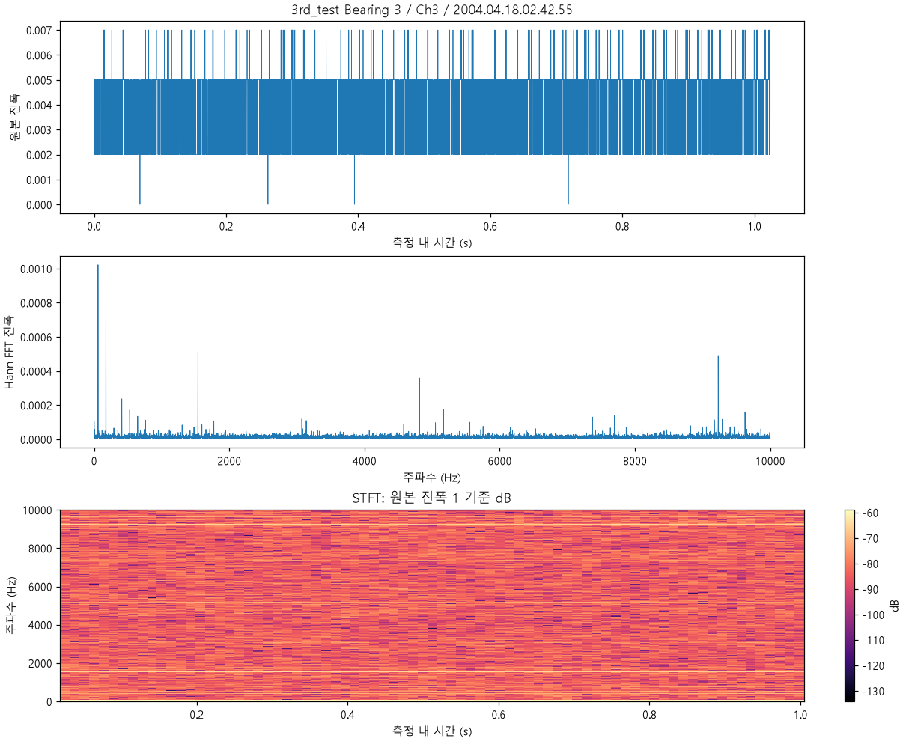
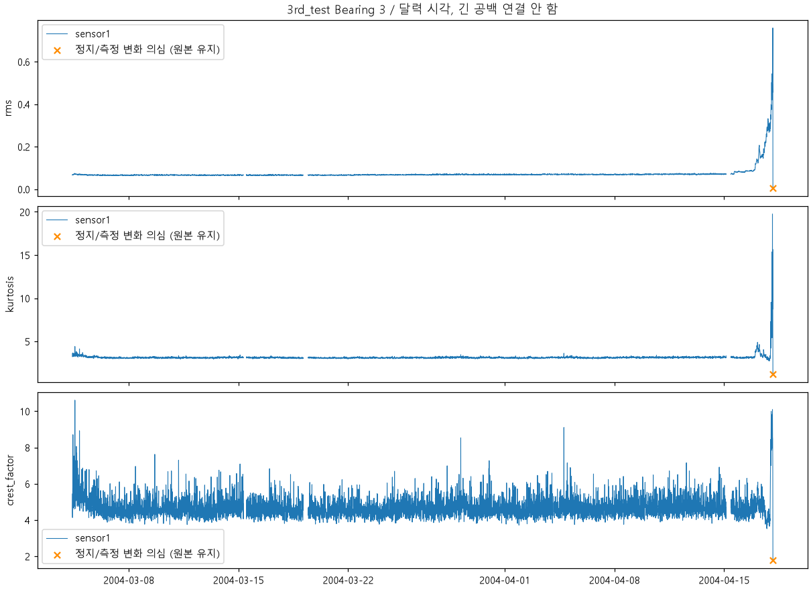
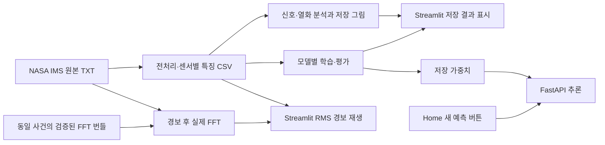

# NASA IMS 데이터 기반 베어링 예지보전 (PdM)

프로젝트 기간: 2026.11.02. ~ 2026.11.06.

산업용 베어링 진동 데이터로 신호 분석, 특징 추출, 열화 추세 분석, 잔여수명(RUL) 예측 실험과 Streamlit 경보 시뮬레이션을 구현한 개인 프로젝트입니다. NASA IMS의 세 시험을 분석하고, 성능 개선 여부와 데이터·평가의 한계를 함께 기록합니다.

**교육·포트폴리오 목적의 프로토타입입니다. 산업 현장에 즉시 적용할 수 있는 검증된 예지보전 제품이 아니며, 실제 설비 제어·실시간 물리 센서 연동을 제공하지 않습니다.**

- [Streamlit 시연](https://bearing-pdm.streamlit.app/): 실제 측정 기록의 RMS 재생과 경보, 실제 TXT에서 계산한 FFT 워터폴
- 분석: 시간 파형, RMS, FFT/STFT, 베어링별 열화 추세
- RUL 실험: Random Forest 기본 모델·이동 통계 특징 실험·Ridge Regression
- 별도 실험: BiLSTM 대리 RUL, NASA IMS 대리 결함 라벨 분류
- 추론 인터페이스: 선택적인 FastAPI 호출과 Render/Docker 배포 설정

## 데이터셋과 사용 범위

### NASA IMS Bearing Dataset

데이터 제공 기관은 University of Cincinnati의 Center for Intelligent Maintenance Systems(IMS)입니다. 원본은 [NASA PCoE 데이터 저장소의 Bearings 항목](https://www.nasa.gov/intelligent-systems-division/discovery-and-systems-health/pcoe/pcoe-data-set-repository/)에서 안내하며, [원본 다운로드](https://phm-datasets.s3.amazonaws.com/NASA/4.+Bearings.zip)를 제공합니다.

권장 출처 표기: J. Lee, H. Qiu, G. Yu, J. Lin, and Rexnord Technical Services (2007). IMS, University of Cincinnati. “Bearing Data Set”, NASA Prognostics Data Repository, NASA Ames Research Center, Moffett Field, CA.

[미국 공공데이터 카탈로그의 IMS Bearings 메타데이터](https://catalog.data.gov/dataset/ims-bearings)는 공개 데이터로 안내하고 사용 조건 항목을 [미국 정부 저작물 안내](https://www.usa.gov/government-works)에 연결합니다. 재사용 시 배포본에 동봉된 설명·권리 고지와 출처 표기를 함께 확인해야 합니다. 이 저장소가 원본 데이터에 별도의 라이선스를 부여하는 것은 아닙니다.

| 시험 | 원본 측정 파일 수 | 센서 매핑 | 종료 시 보고된 결함 | 전처리 CSV 행 수 |
|---|---:|---|---|---:|
| `1st_test` | 2,156 | B1 = Ch1·2, B2 = Ch3·4, B3 = Ch5·6, B4 = Ch7·8 | B3 내륜, B4 전동체 | 17,248 |
| `2nd_test` | 984 | B1 ~ 4 = Ch1 ~ 4, 각 1개 센서 | B1 외륜 | 3,936 |
| `3rd_test` | 6,324 | B1 ~ 4 = Ch1 ~ 4, 각 1개 센서 | B3 외륜 | 25,296 |

세 시험의 전체 베어링·센서는 RMS 모니터링에 사용합니다. RUL 학습·평가는 종료 결함이 보고된 베어링만 선택하며, 나머지 베어링을 정상 정답으로 확정하지 않습니다.

**3rd Test 배포본 차이:** 현재 원본은 2004-03-04 09:27:46부터 2004-04-18 02:42:55까지 6,324개입니다. [동봉 명세 PDF](reports/evaluation/ims_data_readme.pdf)의 4,448개와 다릅니다. 코드는 현재 배포본의 파일 수·시작·종료 시각을 검사합니다. 관련 근거는 [데이터 감사](reports/evaluation/ims_data_audit.json), [전처리 기록](reports/evaluation/preprocessing.json), [PHM 논문](https://papers.phmsociety.org/index.php/phme/article/download/2947/1761), [Sensors 논문](https://www.mdpi.com/1424-8220/24/23/7769)과 [공개 본문](https://pmc.ncbi.nlm.nih.gov/articles/PMC11644926/)에 연결되어 있습니다. 마지막 기록 시각을 정확한 고장 발생 시각으로 단정하지 않습니다.

### 데이터 배치와 GitHub 포함 범위

현재 로컬 원본 구조는 다음과 같습니다. 측정 파일은 `.txt` 확장자 없이 날짜가 파일명인 텍스트 파일입니다.

```text
data/
├── raw/                             # 원본 9,464개, 약 6.53 GB; Git 제외
│   ├── 1st_test/1st_test/            # 예: 2003.10.22.12.06.24
│   ├── 2nd_test/2nd_test/            # 예: 2004.02.12.10.32.39
│   └── 3rd_test/                     # 예: 2004.03.04.09.27.46
├── processed/
│   ├── 1st_test.csv                  # Git 추적: 센서별 특징·시간·라벨·출처
│   ├── 2nd_test.csv                  # Git 추적
│   ├── 3rd_test.csv                  # Git 추적
│   └── features_enhanced.csv         # 로컬 학습용 통합 파일; Git 제외
└── demo_fft/                         # Git 추적: 6개 사건의 NPZ·출처 JSON
```

GitHub 복제본은 전처리 CSV와 FFT 번들로 대시보드를 표시할 수 있습니다. 원본 분석이나 전체 전처리를 재현하려면 NASA 배포본을 별도로 다운로드·압축 해제하여 위 경로에 배치합니다. CSV의 `source_path`는 프로젝트 루트 기준 상대경로이므로, 저장된 CSV로 로컬 FFT를 계산할 때는 중첩 폴더까지 맞춰야 합니다. 전처리 탐색 자체는 각 시험 폴더 하위를 재귀 검색합니다.

현재 실행 코드·데이터에서 AI Hub 기계시설물 고장 예지 센서 데이터 사용은 확인되지 않습니다. 과거 보존 목록에 AI Hub·CNN 파일명이 남아 있지만, 이를 현재 구현 또는 NASA와 통합한 RUL 학습 데이터로 기술하지 않습니다. XJTU-SY도 최종 분석 데이터셋으로 사용하지 않았습니다.

## 전처리와 신호 분석

[src/preprocessing.py](src/preprocessing.py)는 파일명의 시각을 파싱하고 시험별로 정렬합니다. 헤더·시간 열이 없는 원본에서 **20,480행 × 8열(1st) 또는 4열(2nd/3rd)**과 유한값을 검사한 뒤 센서별 특징을 추출합니다. 샘플링 주파수는 **20,000 Hz**, 한 기록 길이는 **1.024초**입니다. 이는 연속 운전 전체를 기록한 신호 길이가 아니라 각 측정 스냅샷의 길이입니다.

| 처리 | 실제 구현 |
|---|---|
| 시간 영역 | 원본 파형, RMS, 모집단 표준편차 `std`, 절대 최댓값 `peak` |
| 분포·충격 특징 | Pearson 첨도 `kurtosis`(정규분포 기준 3), `crest_factor = peak / RMS` |
| 주파수 특징 | 평균 제거·Hann 창 FFT, 진폭 제곱 가중 주파수 중심, 상위 3개 FFT bin의 주파수·진폭 |
| 품질 정보 | 상수 신호 여부, 평균에서 8표준편차 초과 샘플 수, 측정 공백·품질 의심 기록 |
| FFT 분석 | 단측 진폭 스펙트럼, 창 합과 DC/Nyquist 보정; 전체 기록의 주파수 간격 약 0.9766 Hz |
| STFT 분석 | Hann 창 1,024샘플, 중첩 75%, hop 256; 주파수 간격 19.53125 Hz, 시간 간격 0.0128초 |

신호 분석은 [src/signal_processing.py](src/signal_processing.py)에 구현되어 있습니다. STFT는 신호 내부의 완전한 창만 사용하고 진폭 1 기준 `20 log10`으로 표시합니다. 센서 물리 단위가 확정되지 않아 물리적 절대 소음 수준으로 해석하지 않습니다. 상위 FFT bin들은 같은 피크의 이웃일 수도 있으며 고유 결함 주파수의 식별 결과는 아닙니다.

시험별 CSV는 센서 정보를 유지합니다. [src/feature_engineering.py](src/feature_engineering.py)는 세 CSV를 결합하고 시험·베어링별 첫 번째 센서를 선택해 `features_enhanced.csv`를 만듭니다. 시험·베어링·연속 측정 구간 안에서 현재와 과거 기록만 사용하며, 1,200초 초과 공백이나 측정 순번 누락에서 구간을 나눕니다.

추가 특징은 **5개**입니다: `rms_ma6`, `rms_ma36`, `rms_std36`, `rms_diff6`, `kurtosis_ma6`. 기본 6개와 합쳐 총 11개이며, 6개를 새로 추가한 모델이 아닙니다. 이동창의 6·36은 측정 개수로, 항상 고정된 실제 시간 길이를 뜻하지 않습니다.

### 저장된 분석 예시

실제 원본의 시간 파형·FFT·STFT와 RMS 열화 분석 그림입니다. 대시보드 스크린샷은 확인되지 않아 포함하지 않았습니다.





추가 자료: [1st Test 시간축·대리 RUL](reports/figures/ims_1st_test_nasa_rul_timeline.png), [RF 내부 시간순 평가](reports/figures/rf_basic_predictions.png), [RF 실험 분리 평가](reports/figures/rf_basic_holdout_test.png).

## RUL 라벨의 정의

**본 프로젝트의 정답은 실제 고장까지 관측한 잔여수명이 아니라 시험 관측 종료까지 남은 시간을 계산한 대리 RUL(Proxy RUL)입니다.**

```text
rul_calendar_hours_proxy = (해당 시험의 마지막 측정 시각 − 현재 측정 시각) / 1시간
```

- 단위는 시간이며, 시작부터 현재까지의 경과시간과 구분합니다. `elapsed_calendar_hours`는 별도의 경과시간 열입니다.
- 종료 결함 보고 베어링에만 RUL 라벨을 부여합니다. 그 외 베어링은 RUL 결측으로 보존합니다.
- 시험 종료와 고장 시작·고장 확정·교체 시점이 정확히 일치한다고 가정하지 않습니다.
- 기록 공백도 달력 시간에 포함됩니다. 공백 전체를 제외한 참고 대리값과 남은 측정 횟수도 저장하지만, 실제 가동시간은 알 수 없어 관련 열을 결측으로 둡니다.
- 일부 종료 직전 동시 급락은 정지·측정 상태 변화 의심으로 표시합니다. 원인을 확정하거나 원본·특징 행을 삭제하지 않습니다.
- 라벨은 시험 종료 후 생성한 회고적 값입니다. 같은 라벨로 학습한 모델을 당시 실시간으로 운용할 수 있었다는 의미가 아닙니다.

## 머신러닝 실험과 평가 결과

MAE·RMSE 단위는 시간입니다. **분할, 센서 집계, 입력 특징, 평가 대상이 다르므로 아래 전체 표를 동일 조건의 모델 순위로 해석하지 않습니다.** 음수 R²는 해당 평가 정답 평균을 사용하는 상수 예측보다 제곱오차가 크다는 의미입니다.

기본 신호 특징 6개는 `rms`, `std`, `peak`, `kurtosis`, `crest_factor`, `fft_centroid_hz`입니다. 신호 특징 12개는 여기에 상위 FFT bin 3개의 주파수·진폭 6개를 더한 구성입니다.

| 모델·평가 | 사용 특징 | 학습 / 설정 선택 / 평가 | MAE | RMSE | R² |
|---|---|---|---:|---:|---:|
| RF Basic 내부 시간순 | 센서별 12개 × 2 = 24개 | 1st B3·4의 앞 80% / 별도 선택 없음 / 뒤 20%, 864행 | 90.4298 | 104.0858 | -15.8119¹ |
| RF Basic 실험 분리 | 베어링·시점별 센서 평균 12개 | 1st B3·4 / 2nd B1 / 3rd B3, 6,324행 | 322.1357 | 395.7121 | -0.6347 |
| RF 비교 실험: 기본 6개 | 첫 센서의 기본 6개 | 1st B3·4 / 2nd B1에서 특징 구성 비교 / 별도 최종 시험 없음 | 500.6048 | 548.9559 | -133.4525 |
| RF Engineered | 기본 6개 + 이동 통계 5개 = 11개 | 위와 같은 1st 학습 → 2nd 검증 | 613.0789 | 656.5044 | -191.2956 |
| Ridge Regression | 첫 센서의 기본 6개 | 1st+2nd 재학습 / 사전에 1st→2nd로 alpha 선택 / 3rd B3 | 340.8485 | 422.6144 | -0.8645 |

¹ RF Basic 내부 평가 JSON에는 R²가 기록되지 않아, README 점검 시 [저장 예측 CSV](reports/predictions/rf_basic_predictions.csv)의 864행에서 재계산했습니다. MAE·RMSE도 기록과 일치했습니다. Ridge도 [저장 예측 CSV](reports/predictions/ridge_test3_predictions.csv)로 세 지표를 확인했습니다. 재학습은 수행하지 않았습니다.

- **RF Basic 내부 평가:** 같은 시험·수명 궤적 안의 회고적 평가입니다. 1,724개 측정 시점 학습, 432개 시점 평가로 나누며 동일 시각의 B3·4를 같은 분할에 둡니다. 중앙값 대체는 학습 부분에만 적합합니다. 마지막 학습 정답 고정 기준(MAE 40.6062, RMSE 47.8882)보다 오차가 큽니다. RF의 학습 정답 범위 밖 외삽 한계도 있습니다.
- **RF Basic 실험 분리:** 1st의 두 센서는 특징 평균을 내고, 2nd·3rd는 단일 센서를 사용합니다. 2nd에서 선택한 모델의 검증 지표는 MAE 585.1451, RMSE 641.5834, R² -182.6539입니다. 시험은 분리했지만 독립 수명 사례가 적고 측정 조건도 다릅니다.
- **RF 특징 실험:** 두 구성은 같은 1st→2nd 조건으로 비교했으며, 추가 특징의 성능 개선이 확인되지 않았습니다. 비교 CSV만 저장되어 가중치·개별 예측 파일이 없습니다. `rf_basic_holdout.joblib`은 이 특징 추가 모델이 아닙니다.
- **Ridge:** 결측 중앙값 대체 → 표준화 → Ridge 구조입니다. 2nd 검증 MAE로 `alpha=1000`을 선택하며 음수 예측은 0으로 제한합니다. 코드가 3rd 결과를 이미 본 탐색적 평가임을 명시하므로, 엄격히 미관측인 최종 검증 성능으로 주장하지 않습니다. 배포 가중치 `ridge_all_tests.joblib`은 세 시험 모두 학습한 모델이며 위 1st+2nd 학습 평가 모델과 구분합니다.

평가 근거: [RF 내부 평가](reports/evaluation/rf_basic_metrics.json), [RF 실험 분리 평가](reports/evaluation/rf_basic_holdout_metrics.json), [RF 특징 비교](reports/evaluation/rf_engineered_feature_comparison.csv), [Ridge alpha 검증](reports/evaluation/ridge_validation_alpha.csv).

Ridge의 추가 leave-one-test-out 결과는 다음과 같습니다. 설정 선택에 2nd를 사용했으므로 세 fold 모두 독립적인 최종 검증으로 보지 않습니다.

| 학습 시험 | 제외·평가 시험 | MAE | RMSE | R² |
|---|---|---:|---:|---:|
| 2nd+3rd | 1st | 165.5150 | 215.7589 | 0.1577 |
| 1st+3rd | 2nd | 360.0537 | 372.6608 | -60.9614 |
| 1st+2nd | 3rd | 340.8485 | 422.6144 | -0.8645 |

근거: [Ridge 실험 제외 평가](reports/evaluation/ridge_leave_one_test_out.csv).

### 별도 실험: BiLSTM 대리 RUL

[src/train_bilstm_rul.py](src/train_bilstm_rul.py)는 1st B3·4의 신호 특징 **24개 × 과거 16시점**을 사용합니다. 같은 80/20 분할 안에서 시퀀스를 각각 만들며, 분할 경계·1,200초 초과 공백을 넘지 않습니다. 양방향 처리는 최종 입력 시점까지의 과거 관측 안에서만 수행합니다.

학습 2,954개·평가 676개 시퀀스, hidden size 32, 20 epoch, CPU 학습 기록이 있습니다. 준비 구간·공백으로 제외된 시점이 있어 RF 전체 평가 864행과 직접 비교할 수 없습니다.

| 동일한 평가 최종 시점 676개 | MAE | RMSE |
|---|---:|---:|
| BiLSTM | 57.4987 | 66.8814 |
| 기존 RF 재평가 | 86.2277 | 99.5308 |
| 마지막 학습 정답 고정 | 38.2095 | 45.0701 |

BiLSTM도 마지막 학습 정답 고정 기준 대비 개선을 입증하지 못했습니다. R²는 해당 실험 보고서에 기록되지 않았습니다. [실험 보고서](reports/bilstm_rul/evaluation.md)와 [체크포인트 복원 검증](reports/bilstm_rul/restoration_verification.json)에 근거하며, 복원 기록은 재학습 없이 676개 예측을 확인합니다. 현재 Streamlit·FastAPI 제공 모델에는 포함되지 않습니다. PyTorch는 두 requirements 파일에 없어 기본 UI/API 설치만으로 재현되지 않습니다.

### 별도 실험: NASA IMS 결함 종류 분류

[src/train_ims_fault_types.py](src/train_ims_fault_types.py)는 종료 결함이 보고된 네 베어링 사례의 첫 센서·신호 특징 12개로 Random Forest 분류를 수행합니다. 초기 20%를 `Normal proxy`, 마지막 5%를 내륜·전동체·외륜 결함으로 가정하며, 중간 75%는 제외합니다.

각 사례의 초기·말기 구간 안에서 앞 70%를 학습하고 경계 간격을 제외한 뒤 뒤쪽을 평가합니다. 학습 2,032행·평가 829행에서 **Accuracy 0.973462, Macro F1 0.881063**입니다. 다수 클래스 기준은 Accuracy 0.815440, Macro F1 0.224585입니다.

이 값은 같은 베어링 내부의 대리 라벨 진단 결과입니다. 말기 학습 데이터가 초기 평가 데이터보다 미래이므로 전체 수명에 대한 전역 시간순 예측이 아닙니다. 실제 고장 시작 라벨·외부 설비 일반화 성능으로 해석하지 않습니다. 전역 시간순 진단은 학습에 결함 클래스가 없어 유효한 네 클래스 검증이 불가능했습니다. [상세 보고서·클래스별 결과](reports/ims_fault_types/evaluation.md)를 참고하세요. AI Hub 분류 실험과는 다릅니다.

## Streamlit 경보 시연

[공개 시연 주소](https://bearing-pdm.streamlit.app/)의 로컬 소스는 [app.py](app.py)입니다. 메뉴는 Home / Chart / Logs / User Info이며, 기본 결함 사례는 **3rd Test Bearing 3 센서 1의 외륜 결함 사례**입니다. 결함 명칭은 설명용이며 경보 계산에 사용하지 않습니다.

### 경보 판정과 재생

1. `data/processed`의 실제 RMS·측정 시각을 순서대로 검사합니다.
2. 기준 후보는 초기 **10%(올림), 최대 300개**입니다. 유효한 양수·유한 RMS만 사용하며 최소 10개 및 후보의 80% 이상이 필요합니다. 후보 창은 확장하지 않습니다.
3. 기준 중앙값을 `m`, MAD를 중앙값 절대편차라 하면 보정 산포는 `s = max(1.4826 × MAD, m × 0.02, 1e-8)`입니다.
4. 민감도 배수 `k`에 대해 Warning=`m+k×s`, Alarm=`m+2k×s`, Critical=`m+3k×s`를 사용합니다.
5. 단계별 연속 초과를 독립적으로 계산하고 확정된 최고 단계를 유지합니다. 비정상·결측 RMS 및 초기 측정 간격 중앙값의 3배 초과 공백은 연속 횟수를 끊습니다.
6. 기본 시연은 **MAD 배수 5 / 연속 3회 / Alarm**입니다. 분석 모드는 배수 5·7·10, 연속 3·4·5회와 트리거 단계를 선택합니다.
7. 선택 단계가 처음 확정된 지점에서 재생을 끝내고 FFT 워터폴을 준비합니다. 전체 기록은 검사하되 화면은 해당 지점까지 최대 48개 기록만 재생합니다. 경보가 없으면 마지막 기록까지 표시합니다.

초기 기준은 정상 상태를 보증하지 않습니다. 코드가 초기 상승 추세·유효값·이상 후보를 별도로 기록합니다. 경보 결과와 전체 RMS는 세션에 유지되고 초기화 버튼으로 지울 수 있습니다. 구현 근거는 [src/ims_alarm.py](src/ims_alarm.py)입니다.

### 원본 FFT와 클라우드 번들

경보 후 FFT는 RMS 그래프와 별개의 원본 분석입니다. 로컬에서는 CSV의 `source_path`로 실제 진동 TXT를 읽고, 직전 최대 48개 측정 범위에서 최대 16개를 선택합니다. 평균 제거·Hann FFT 후 **0 Hz 초과~5,000 Hz**를 160개 구간의 최대 진폭으로 축약해 워터폴을 그립니다. 원본 RMS와 CSV RMS의 센서 매핑도 대조하며 실제 원본 최소 2개가 필요합니다.

클라우드에 전체 원본을 넣지 않으므로, 원본이 없는 경우 [src/cloud_waterfall.py](src/cloud_waterfall.py)가 `data/demo_fft`의 사전 계산된 실제 TXT FFT를 사용합니다.

| 번들 지원 사례 | 조건 |
|---|---|
| 1st B3 S1·S2, 1st B4 S1·S2 | MAD 5 / 연속 3회 / Alarm |
| 2nd B1 S1, 3rd B3 S1 | MAD 5 / 연속 3회 / Alarm |

총 6개 사건이며 각각 NPZ와 출처 JSON이 있습니다. 사건·설정·CSV 시각/RMS/경로·알고리즘·번들 해시가 일치해야 로딩하며, `allow_pickle=False`를 사용합니다. 화면은 사전 계산된 실제 FFT임을 표시합니다.

지원 밖의 조건에서는 **RMS 경보 시뮬레이션은 가능해도 원본 없는 FFT는 제한**됩니다. 원본이 일부라도 있는 계산 오류를 번들로 우회하지 않습니다. 파일 부족·RMS 매핑 불일치·번들 검증 실패 시 안내를 표시하며 합성 신호로 대체하지 않습니다.

경보 조건 9조합 × 3단계 × 16센서의 432행 비교는 [비교 CSV](reports/evaluation/ims_alarm_comparison.csv), [분석 설명](reports/evaluation/ims_alarm_analysis.md)에 보존되어 있습니다.

## 시스템 구조와 배포 상태



Streamlit은 저장된 CSV·보고서·이미지를 직접 읽습니다. **Home의 ‘새 RUL 예측 · FastAPI’에서 버튼을 누를 때만 API를 호출**합니다. API 장애가 있어도 저장 결과·RMS 경보는 별도로 동작합니다. 새 요청의 특징은 선택한 측정 CSV에서 구성합니다.

| 구성 | 확인된 구현·검증 상태 |
|---|---|
| Streamlit Cloud | 제공된 공개 주소는 위 링크. 이번 README 점검 도구에서는 접속을 확인하지 못했으며 원격 화면·실제 배포 리비전은 미검증 |
| 로컬 FastAPI | `api.py`의 `app`; 저장된 실제 HTTP 점검에서 `/health`, `/docs` 200 및 Streamlit 새 예측 연동 PASS |
| Render | `render.yaml`에 Docker 서비스·`/health` 설정 존재. 저장 배포 보고서는 미배포이며 현재 실제 Render 서비스 주소·상태는 확인되지 않음 |
| Docker | API 전용 `Dockerfile` 존재. 저장 기록상 Docker 엔진 연결 실패로 이미지 빌드·컨테이너 실행 미검증 |

근거: [로컬 HTTP 검증](reports/evaluation/deployment_live_check.json), [배포 검증 기록](reports/evaluation/deployment_verification.json). 이 보고서의 Cloud 미배포 기록은 과거 로컬 검증 상태이므로 현재 공개 주소의 운영 상태를 확정하는 근거로 사용하지 않습니다. 자세한 배포 환경 구성, 실행 방법, 데이터 번들 관리 및 문제 해결 방법은 [DEPLOYMENT.md](DEPLOYMENT.md)를 참고하세요.

FastAPI 엔드포인트는 `GET /health`, `GET /models`, `POST /predict/rul`, `GET /docs`입니다. 가중치는 요청 시 지연 로딩하며 manifest의 해시·버전·특징을 확인합니다. 현재 추론 가능한 모델 ID는 `rf_basic`, `rf_basic_holdout`, `ridge`이고, `rf_engineered`는 가중치가 없어 503을 반환합니다. BiLSTM·결함 분류는 API에 연결되지 않습니다.

잘못된 모델 ID, 특징 누락·추가, 비수치·비유한 값 등은 **HTTP 422**로 거부합니다. 이는 코드와 테스트에서 확인되는 입력 검증 동작입니다. 현재 공개 배포에서 지속되는 422 장애의 원인·해결 여부는 확인하지 못했으므로 해결 완료로 주장하지 않습니다. API 주소는 환경변수 `API_BASE_URL` → Streamlit Secrets → `http://localhost:8000` 순서로 결정합니다. 실제 Secrets는 Git에서 제외합니다.

## 프로젝트 구조

현재는 Python 스크립트·앱 중심이며 `.ipynb`와 `pyproject.toml`은 확인되지 않습니다.

```text
bearing-pdm/
├── README.md
├── app.py                          # Streamlit UI·경보·FFT
├── api.py                          # FastAPI 추론
├── requirements.txt                # UI·신호 분석
├── requirements-api.txt            # API·scikit-learn·joblib
├── Dockerfile
├── render.yaml
├── DEPLOYMENT.md
├── .streamlit/secrets.toml.example
├── deployment/                     # manifest·입력 명세·요청 예제
├── src/
│   ├── preprocessing.py
│   ├── signal_processing.py
│   ├── feature_engineering.py
│   ├── feature_columns.py
│   ├── train_rul_baseline.py        # RF Basic 두 평가 방식
│   ├── train_rf_enhanced.py
│   ├── train_ridge_ims.py
│   ├── train_bilstm_rul.py
│   ├── verify_restored_bilstm.py
│   ├── train_ims_fault_types.py
│   ├── demo_support.py             # 저장 결과 로딩·분석 그림
│   ├── ims_alarm.py
│   ├── analyze_ims_alarm.py
│   ├── api_client.py
│   ├── cloud_waterfall.py
│   └── build_cloud_waterfall.py
├── tests/                          # 신호·분할·경보·UI·API·번들 검사
├── data/                           # 위 데이터 구조 참고
├── models/                         # RF 2종·Ridge·로컬 BiLSTM 체크포인트
└── reports/
    ├── evaluation/                 # 평가·분할·출처·배포 검증
    ├── figures/                    # 신호·열화·RF 그림과 경보 HTML
    ├── predictions/                # 저장 RUL 예측 CSV
    ├── bilstm_rul/                 # 별도 시퀀스 실험·복원 검증
    └── ims_fault_types/            # 별도 분류 모델·지표·그림
```

README 점검 시 BiLSTM·결함 분류 관련 일부 소스·가중치·보고서는 로컬에는 있으나 Git 미추적 상태였습니다. 이 문서는 현재 작업 트리를 설명하며, 해당 파일들이 GitHub에 이미 게시되었다는 뜻은 아닙니다. 과거 보고서의 절대경로·삭제된 파일명은 실행 당시 이력으로만 취급합니다.

## Windows PowerShell / VS Code 실행

### 환경과 대시보드

설비 예지보전 제어반 https://bearing-pdm.streamlit.app/

VS Code에서 저장소 폴더를 열고 프로젝트 루트의 PowerShell 터미널을 사용합니다. 기존 검증 보고서의 Python 버전은 **3.12.7**이며, 새 환경은 Python 3.12를 기준으로 합니다.

```powershell
py -3.12 -m venv .venv
.\.venv\Scripts\python.exe -m pip install -r requirements.txt
.\.venv\Scripts\python.exe -m streamlit run app.py
```

선택적으로 `.\.venv\Scripts\Activate.ps1`로 활성화할 수 있습니다. 실행 정책으로 활성화가 제한되어도 위처럼 가상환경 Python을 직접 지정할 수 있습니다. VS Code 인터프리터도 `.venv\Scripts\python.exe`를 선택합니다.

UI용 의존성은 NumPy, pandas, SciPy, Matplotlib, Streamlit, Plotly, requests이며 버전은 [requirements.txt](requirements.txt)에 고정되어 있습니다. 저장 CSV·보고서 표시에는 재학습과 원본 다운로드가 필요하지 않습니다. 설치 명령은 구성 기준 안내이며 이번 문서 수정 중 새 패키지 설치는 수행하지 않았습니다.

### 로컬 API

ML 학습·저장 파이프라인 추론에는 [requirements-api.txt](requirements-api.txt)의 scikit-learn·joblib와 API 의존성도 필요합니다.

```powershell
.\.venv\Scripts\python.exe -m pip install -r requirements.txt -r requirements-api.txt
.\.venv\Scripts\python.exe -m uvicorn api:app --host 0.0.0.0 --port 8000
```

다른 터미널에서 Streamlit을 실행합니다. 로컬 기본 API 주소는 `http://localhost:8000`이고 Swagger는 `http://localhost:8000/docs`입니다.

```powershell
Invoke-RestMethod http://localhost:8000/health
Invoke-RestMethod http://localhost:8000/models
Invoke-RestMethod http://localhost:8000/predict/rul -Method Post -ContentType 'application/json' -Body (Get-Content deployment/examples/ridge.json -Raw)
```

클라우드는 로컬 `data/raw`나 `localhost` API를 사용할 수 없습니다. 전처리 CSV·번들은 배포 저장소에 포함하고, 새 API 예측을 사용하려면 배포된 API 주소를 `API_BASE_URL` 환경변수 또는 Streamlit Secrets에 설정합니다. API Docker 이미지는 데이터셋을 포함하지 않고 가중치 3개·manifest·추론 코드만 복사합니다.

### 전처리·학습·평가 재현

아래는 **수동 재현을 위한 코드 기준 명령**입니다. 이번 README 작업에서는 전처리·재학습을 실행하지 않았습니다. 모델 학습 스크립트가 학습과 평가·보고서 저장을 함께 수행합니다.

원본을 위 경로에 준비한 뒤, 기존 전처리 파일을 보존하려면 새 출력 경로를 지정합니다. 아래 `data/reprocessed` 등은 실행 시 생성할 예시 경로입니다.

```powershell
.\.venv\Scripts\python.exe -m src.preprocessing --input data/raw --experiment all --output-dir data/reprocessed --report-output reports/reproduction/preprocessing.json
```

현재 3rd Test 처리기는 6,324개·정해진 시작/종료 시각을 요구합니다. 다른 배포본은 자동 수용하지 않습니다. 기존 출력 파일이 있으면 중단합니다.

현재 저장 CSV로 RF를 별도 출력 위치에 재현하는 예시입니다.

```powershell
.\.venv\Scripts\python.exe -m src.train_rul_baseline --input data/processed/1st_test.csv --model-output models/reproduction_rf_basic.joblib --report-dir reports/reproduction_rf_basic
.\.venv\Scripts\python.exe -m src.train_rul_baseline --experiment-split --data-dir data/processed --trees 200 --model-output models/reproduction_rf_holdout.joblib --report-dir reports/reproduction_rf_holdout
```

새 전처리 결과를 사용할 경우 위 입력 경로를 `data/reprocessed`에 맞춥니다. 시간순 RF는 기본 300개 트리이고, 실험 분리 저장 결과는 200개 트리이므로 두 번째 예시에서 명시했습니다.

특징 통합과 RF Engineered·Ridge의 엔트리포인트는 다음과 같습니다. **이 세 명령은 복사한 별도 작업 공간에서 실행하는 것을 전제로 합니다.** 특징 생성은 `features_enhanced.csv`를 덮어쓰며, RF Engineered·Ridge는 기존 평가·모델이 있으면 중단합니다. 현재 결과를 지우고 재실행하는 절차는 포함하지 않습니다. 두 학습기는 출력 경로 CLI를 제공하지 않습니다.

```powershell
.\.venv\Scripts\python.exe -m src.feature_engineering
.\.venv\Scripts\python.exe -m src.train_rf_enhanced
.\.venv\Scripts\python.exe -m src.train_ridge_ims
```

특징 생성은 `data/processed` 아래 적합한 CSV를 재귀 수집하므로, 별도 재처리 CSV를 그 안에 중복 배치하면 중복 검사에서 실패할 수 있습니다. GitHub에서 제외된 `features_enhanced.csv`가 없을 때는 기존 시험별 CSV로 먼저 생성합니다.

신호·열화 그림 재생성은 원본과 한글 글꼴(Windows 맑은 고딕 등)이 필요합니다. 기존 보고서를 보존하는 출력 예시입니다.

```powershell
.\.venv\Scripts\python.exe -m src.demo_support --figures --experiment all --output-dir reports/reproduction_figures
.\.venv\Scripts\python.exe -m src.analyze_ims_alarm --output reports/reproduction_alarm
```

BiLSTM은 별도 PyTorch 환경이 필요하며, 기록된 버전은 `2.14.0+cu126`입니다. 이 저장소의 requirements에는 포함되어 있지 않습니다. 추가 실험의 실행 옵션·결과는 위 별도 보고서와 소스를 참고하며 기본 UI/API 실행 절차와 구분합니다.

검증 테스트의 엔트리포인트는 다음과 같습니다. 전체 테스트는 UI/API 의존성 외 `httpx` 등 테스트용 환경이 필요하며, 일부 검사는 원본·로컬 실험 산출물에 의존하고 실제 HTTP 테스트는 8000 포트를 사용합니다. 과거 49개 통과 기록은 당시 상태이며 현재 전체 테스트 통과를 의미하지 않습니다.

```powershell
.\.venv\Scripts\python.exe -m unittest discover -s tests -v
```

## 한계와 개선 방향

- **대리 RUL:** 관측 종료 기준 라벨이므로 실제 설비의 잔여수명·교체일·고장 시작 시각을 검증하지 못합니다. 긴 기록 공백과 품질 의심 종료 기록의 영향도 남아 있습니다.
- **일반화:** 세 시험과 소수의 결함 사례만 사용합니다. 같은 시험 내 시간순 분할은 독립 설비 검증이 아니며, 시험 분리 평가도 센서 구성·운전 조건 차이와 적은 독립 사례 수에 제약됩니다.
- **모델 성능:** 다수의 음수 R²와 단순 기준선보다 큰 오차가 확인됩니다. 이동 통계 추가만으로 개선되지 않았고, BiLSTM도 마지막 학습 정답 고정 기준을 넘지 못했습니다.
- **분류 라벨:** 초기·말기 구간으로 만든 임의의 대리 라벨입니다. 결함 종류와 시험·베어링 특성이 혼동될 수 있고, 높은 내부 분류 점수는 외부 고장 진단 성능이 아닙니다.
- **시연 범위:** 검증된 고장 사례 중심의 재생입니다. 장기간 정상 설비의 오경보율, 새 설비·센서, 실제 제어 연동은 검증하지 않았습니다.
- **배포:** 전체 원본을 제외하여 FFT는 정확히 일치하는 번들 사건에 한정됩니다. 공개 API 상태·클라우드 리비전, Docker 실제 실행도 별도 검증이 필요합니다.
- **재현성:** 과거 평가 파일에 이전 경로가 남아 있고, PyTorch·테스트 의존성은 기본 설치 파일에서 완결되지 않습니다. 일부 새 실험 산출물은 아직 Git 미추적입니다.

향후에는 독립 베어링·시험 단위의 분리와 별도 최종 시험셋, 설정 선택을 분리한 검증, 특징 선택·분포 이동 분석, 정상 구간의 오경보율·탐지 지연 평가, 데이터 출처·모델 버전 관리와 배포 통합 검증을 개선할 수 있습니다. 이는 향후 과제이며 현재 구현 완료 기능으로 주장하지 않습니다.
