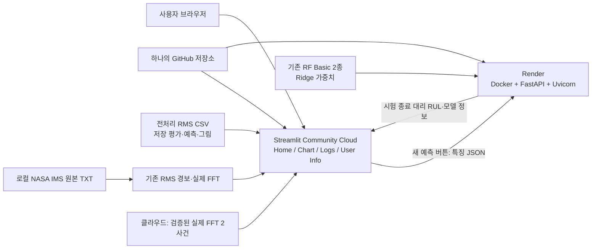

# PPT용 시스템 소개

## 시스템 아키텍처

## 기술 스택과 역할

- Python 3.12, NumPy / pandas / SciPy, scikit-learn / joblib
- Streamlit: 기존 모니터링·시계열·경보 재생·워터폴 및 모델 결과 화면
- FastAPI / Pydantic: HTTP 요청 검증, 허용된 저장 모델의 추론, 오류·상태 응답
- Docker: 백엔드 실행 환경과 모델 호환 버전을 고정해 로컬·Render의 차이를 줄임
- GitHub: UI·API가 함께 사용하는 소스와 검증된 배포 자산 관리
- Streamlit Community Cloud: UI 호스팅 / Render Docker: API 호스팅

## 발표 시 설명할 포인트

1. 기존 가중치를 재사용한다. 서버 시작 시 재학습하지 않으며 요청한 모델만 로딩한다.
2. 새 예측만 API를 호출한다. API가 중단되어도 RMS와 기존 저장 결과는 계속 표시된다.
3. 원본 데이터는 6.53GB라 Docker 이미지에 넣지 않는다. 클라우드에서는 정확히 일치하는 두 경보 사건의 검증된 실제 FFT를 표시한다.
4. RF Engineered는 비교 성능표만 존재하므로 추론 가능한 모델인 것처럼 표시하지 않는다.
5. 예측 목표는 실제 고장 시각이 아닌 **시험 종료 기준 달력 시간 대리 RUL**이다.

## 구현·검증 상태

| 항목 | 결과 |
|---|---|
| FastAPI 3개 엔드포인트·Swagger | 구현 및 실제 localhost HTTP 확인 |
| 저장 파이프라인 직접 예측 vs API | 일치 확인 |
| Streamlit → 실제 FastAPI 요청 | 확인 |
| 잘못된 입력·미존재/불일치 모델 거부 | 확인 |
| API 장애 시 기존 화면 유지 | 확인 |
| 실측 경보·TXT FFT·클라우드 실제 FFT | 확인 |
| 자동 테스트 | 49개 통과 |
| Linux용 두 의존성 파일 해석 | 통과 |
| Dockerfile·Render·Secrets 설정 | 작성 완료 |
| 실제 Docker 빌드·컨테이너 실행 | Docker 엔진 연결 불가로 미완료 |
| 실제 공개 클라우드 배포 | 계정 연결·GitHub push·서비스 생성 필요 |

발표에서는 “로컬 API 연동과 회귀 검증 완료, 컨테이너·클라우드 설정 준비 완료”라고 설명한다. Docker 실행이나 공개 배포가 완료되었다고 표현하지 않는다.
